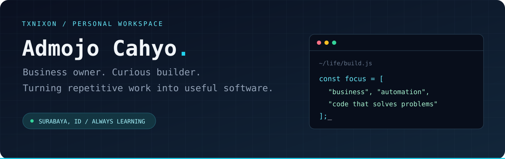

<p align="center">
  
</p>

<p align="center">
  <a href="https://www.slsby.com"></a>
  <a href="mailto:admojocahyo@gmail.com"></a>
  <a href="https://www.instagram.com/admojocahyo/"></a>
</p>

<h3 align="center">🧑‍💻 Business brain · builder hands · automation on the side</h3>

<p align="center">
  <code>Surabaya, Indonesia</code> &nbsp; <code>Learning in public</code> &nbsp; <code>Powered by coffee &amp; curiosity</code>
</p>

## `whoami`

Hey, I’m **Joe** — a business owner, self-taught programmer, and curious builder in Surabaya. I run **SL SBY** and like turning the little operational headaches of a real business into useful software.

My favorite loop is simple: **spot the busywork → sketch a workflow → automate the boring bit → repeat.** I’m learning JavaScript, Python, and full-stack development by building things I can actually use.

```text
CURRENT QUEST  →  connect business systems, automate workflows, explore practical AI
SIDE QUEST     →  finance, markets, and family time
INVENTORY      →  curiosity: unlimited · patience: recharging · bugs: still spawning
```

## `toolbox`

<p>
  
  
  
  
  
  
  
  
  
  
</p>

## `deployments` · built around real problems

| Project | Mission |
| :--- | :--- |
| [**WooCommerce × Paper.id**](https://github.com/TxNixon/wc-paperid) | Connect WooCommerce orders to Paper.id payment links with an unofficial gateway plugin. |
| [**QR / Barcode Receiver**](https://github.com/TxNixon/qrbot_scanner) | A self-hosted scan receiver with WhatsApp OTP login, built with Python and SQLite. |
| [**Customer Tracking**](https://github.com/TxNixon/customer_tracking) | Give customers a simple page to follow their order. |
| [**My Portfolio**](https://github.com/TxNixon/my-portofolio) | A React portfolio made with Tailwind CSS and Framer Motion. |

## `arcade` · after-hours side quest

**Snake.** A little break between builds. Eat, grow, repeat. An animated autoplay loop.

<p align="center">
  
</p>

<details>
<summary><b>📡 Live telemetry · language mix</b></summary>
<br />

<p align="center">
  <a href="https://github.com/TxNixon?tab=repositories"></a>
</p>

Language mix reflects code in public repositories, not proficiency. If the external card is unavailable, [browse my repositories](https://github.com/TxNixon?tab=repositories) or [view my contribution activity](https://github.com/TxNixon#overview).

</details>

<p align="center">
  <b>Useful software starts with a real problem.</b><br />
  <sub>Open to conversations about business, automation, and practical tech.</sub>
</p>
